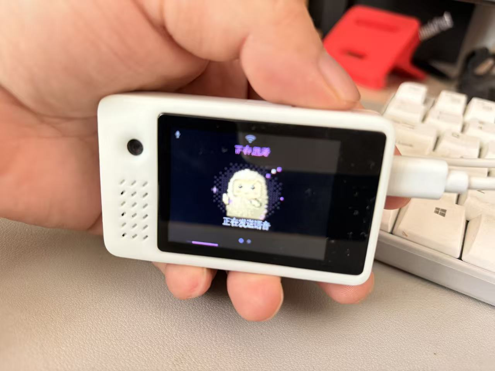
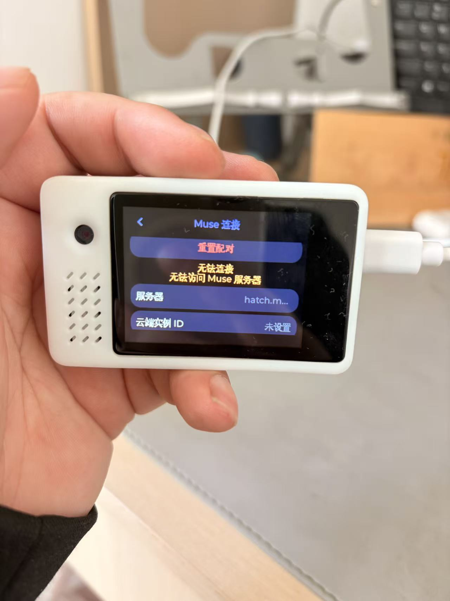
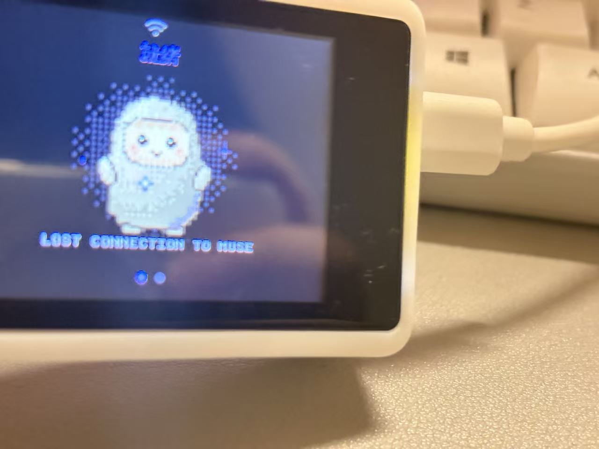
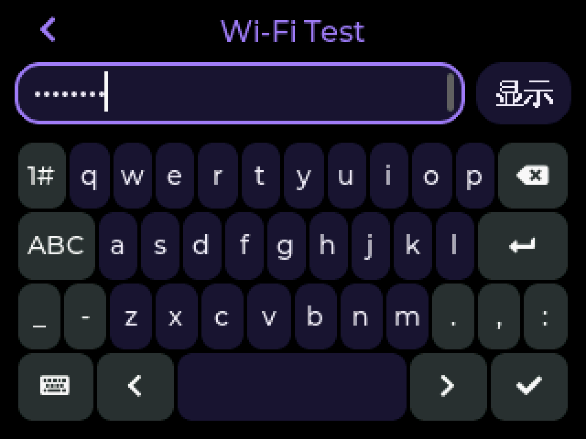

# Muse ESP32-S3 语音与网络中转（待审核草稿）

基于 https://github.com/Liu-zhongxian/muse-esp32-s3-lichuang ，基准提交 e32baa15a926cf8caaeb0f96a7aa629681f253da。补丁包含免按键对话、网络中转和语音播放改动；muse_relay.py 为 Windows 电脑端中转。

本草稿不能直接运行：192.0.2.x 和全零 MAC 是占位值，必须按网络实际配置替换。补丁内的网关、电脑地址和语音地址也须同步配置。中转需要 Python 依赖、本机 DNS 和 HTTP 代理，端口见代码。设备通过 HTTP 把回复文本发送到电脑，在线语音服务再把文字发送给微软；失败时回退 Windows 本地声音。免按键模式持续监听，可能误触发并上传语音。电脑和中转服务必须保持运行。

不要上传 token、Wi-Fi 凭据、构建配置、设备固件备份或个人网络信息。使用时须遵守上游项目许可证和服务条款。

## 图片

以下为设备照片，后两张记录了排查连接问题时的状态：

以下键盘界面图片来自上游立创适配项目：

